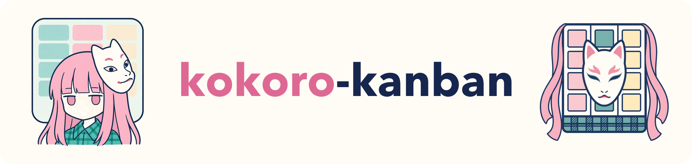

<p align="center">
  
</p>

<p align="center">English | <a href="README.zh-CN.md">简体中文</a></p>

```
 kokoro-kanban  2 sessions · 1 job running · 1 needs you                                      19:52
╭──────────────────────────────────────────────────────────────────────────────────────────────────╮
│ Needs you (1)                                                                                    │
│ ▶ a-9d0e approval Drop the old sessions table? · s-7f3a refactor login · 5m                      │
╰──────────────────────────────────────────────────────────────────────────────────────────────────╯
╭────────────────────────────────────────────────╮╭────────────────────────────────────────────────╮
│ Sessions (2)                                   ││ Jobs (2)                                       │
│ ~/work/app                                     ││ ▶ j-2c91 download model ████████░░ 78% for 12m │
│ ● s-7f3a codex working 2m refactor login       ││     1.2/1.6 GB · shard 3/4 · [s-1b2c]          │
│     rewriting auth middleware                  ││ ✗ j-77aa build failed (exit 1) 15m ago         │
│ ~/thesis                                       ││                                                │
│ ◐ s-1b2c claude waiting 5m fine-tune model     ││                                                │
╰────────────────────────────────────────────────╯╰────────────────────────────────────────────────╯
╭──────────────────────────────────────────────────────────────────────────────────────────────────╮
│ Goals / Next (1)                                                                                 │
│ g-1b2c login refactor (s-7f3a) 1/3 done · doing: migrate middleware · next: add tests            │
│     [x] audit current flow  [~] migrate middleware  [ ] add tests                                │
╰──────────────────────────────────────────────────────────────────────────────────────────────────╯
```

A local execution board for agent sessions. When you have several Codex / Claude Code / Cursor sessions open and downloads or training runs going in the background, you no longer have to ask each conversation "how far along is it?". Agents report through `kokoro` commands as described in the bundled skill, and `kokoro board` shows every session live in your terminal.

kokoro-kanban is an observer: it does not launch or control agents, and it never injects anything into a conversation. All data lives in local files.

## Install

Requires Node 22.22 or later.

```bash
npm install
npm run build
npm link            # provides the kokoro and kokoro-kanban commands
```

Install the skill for your agents:

```bash
kokoro skill install --target codex    # copies to ~/.agents/skills/kokoro-kanban/SKILL.md
kokoro skill install --target claude   # $CLAUDE_CONFIG_DIR/skills/..., default ~/.claude/skills/
kokoro skill install --target cursor   # $CURSOR_CONFIG_DIR/skills/..., default ~/.cursor/skills/
kokoro skill install --dir .agents/skills   # any skills directory, e.g. inside a project
```

Codex reads user skills from `~/.agents/skills` no matter where `CODEX_HOME` points; `$CODEX_HOME/skills` still works but Codex marks it deprecated. Cursor also picks up `~/.agents/skills`, so for Cursor one of the two installs is enough.

Then keep the board open in a terminal:

```bash
kokoro                          # same as kokoro board
kokoro board --here             # only the current project
kokoro board --panel jobs       # only the Jobs panel, handy in a small tmux pane
```

## Four kinds of data

| Entity | ID | Purpose |
|---|---|---|
| session | `s-xxxx` or the agent's own session id | One agent session: what it is doing, its status, when it last updated |
| goal | `g-xxxx` | The current plan: a goal with ordered steps, showing "doing / next" |
| job | `j-xxxx` | A background job or download: progress, elapsed time, exit code; shown as lost if its process dies |
| ask | `a-xxxx` | Something that needs you: a question, a blocker, an approval or a review |

## How agents report

The skill (`skills/kokoro-kanban/SKILL.md`) holds the full conventions. The key idea is to use the session id the host already provides, so the agent never has to remember one:

| Host | Environment variable |
|---|---|
| Codex | `$CODEX_THREAD_ID` |
| Claude Code | `$CLAUDE_CODE_SESSION_ID` |
| Cursor | `$CURSOR_CONVERSATION_ID` |

```bash
kokoro session start --id "$CODEX_THREAD_ID" --agent codex --title "fine-tune classifier"
kokoro goal add --session "$CODEX_THREAD_ID" --title "fine-tune" --step "download data" --step "train" --step "evaluate"
kokoro goal step g-1b2c --set 1=doing
kokoro run --session "$CODEX_THREAD_ID" --title "download dataset" --detach -- hf download org/dataset
kokoro ask add --session "$CODEX_THREAD_ID" --kind approval "Training takes the GPU for two hours. Start now?"
kokoro ask resolve a-4d2f
kokoro session end "$CODEX_THREAD_ID" --summary "accuracy 91%"
```

### Background jobs

`kokoro run [--detach] -- <cmd>` records the pid, log, elapsed time and exit code. If the wrapper process is killed, the board shows the job as lost. The wrapped command receives three environment variables and can report its own progress:

```bash
kokoro job progress "$KOKORO_JOB" --done 3 --total 10 --unit files --msg "batch 3"
echo '{"pct": 30, "msg": "epoch 1/3"}' >> "$KOKORO_PROGRESS_FILE"   # or append a JSON line directly
```

Output from third-party tools (`hf download`, curl and so on) currently only goes to the log; it is not parsed into progress.

## Where data is stored

Writes pick a store directory in this order:

1. `--store <dir>`
2. `$KOKORO_STORE`
3. The nearest `.kokoro-kanban/` found walking up from the current directory (created with `kokoro init`)
4. The global `~/.kokoro-kanban/` (override with `$KOKORO_HOME`)

Project stores are registered in the global `stores.json`. The board reads the global store plus every registered project store, grouped by project.

```
.kokoro-kanban/
  sessions/<id>.json   goals/<id>.json   asks/<id>.json
  jobs/<id>.json   jobs/<id>.progress.jsonl   jobs/<id>.log
  archive/...          archived items
  config.json          global only: { "staleAfterMinutes": 30, "hideFinishedAfterHours": 24 }
  stores.json          global only: registered project stores
```

Every JSON file is written to a temp file and then renamed; progress files are append-only. The file format is the protocol, so scripts can write it directly.

### Agents running in a sandbox

Codex, Cursor and others only allow writes inside the workspace by default, so writing to `~/.kokoro-kanban` is denied. Two ways around it:

- Run `kokoro init` in the project once, yourself, in a normal terminal so it gets registered globally. After that, agent writes land in `.kokoro-kanban/` inside the workspace.
- Add `~/.kokoro-kanban` to the agent sandbox's writable paths (for example Codex's `sandbox_workspace_write.writable_roots`).

## Board keys

| Key | Action |
|---|---|
| `tab` / `shift+tab` | Switch panel |
| `j` / `k`, arrow keys | Move the selection |
| `enter` / `esc` | Open / close details (job details include the last 30 log lines) |
| `1`–`4` / `0` | Single-panel mode / back to overview; `←` `→` switch panels in single-panel mode |
| `x` | Resolve the selected ask |
| `a` | Archive a finished item |
| `p` | Filter by project |
| `.` | Show / hide items finished more than 24 hours ago |
| `q` | Quit |

When `kokoro` runs outside a terminal (for example, an agent calls it by mistake), it prints the `kokoro status` output instead of hanging.

## Other commands

```bash
kokoro status [--here] [--json]   # plain-text snapshot; what agents use to answer "how is it going?"
kokoro archive <id>...            # archive finished items
kokoro doctor                     # list unreadable files and missing project stores
kokoro <command> -h               # options for each command
```

## Development

```bash
npm test            # vitest; builds dist/ with tsup first for the process-level tests
npm run typecheck
npm run dev -- status
```

The design doc is in `docs/superpowers/specs/` and the implementation plan in `docs/superpowers/plans/`.

## License

The code is released under the [MIT License](LICENSE).

The images in `assets/` are fan art of Hata no Kokoro from Touhou Project (© Team Shanghai Alice) and are not covered by the MIT License.
